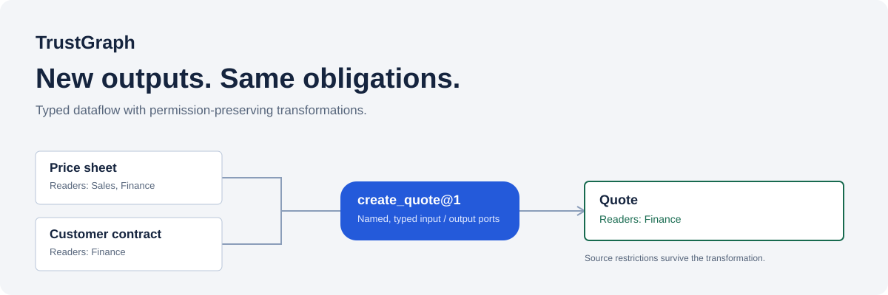

<p align="center">
  
</p>

<p align="center">
  <a href="https://trustgraph-demo.vercel.app/#lab">Try the dataflow lab</a> ·
  <a href="https://trustgraph-demo.vercel.app/#simulator">Run the simulator</a> ·
  <a href="docs/framework.md">Read the framework guide</a> ·
  <a href="docs/verification.md">Inspect verification scope</a>
</p>

# TrustGraph

**A Rust framework that keeps source permissions attached to transformed data.**

A new report, quote or export doesn't arrive with a list of everything that went
into it. TrustGraph records that list as a typed dependency graph, then checks the
whole lineage before the output crosses a boundary.

Not a graph database. Not an LLM judge. A deterministic permission check over
recorded computation.

## The useful part is what survives

```text
Source data              Typed operation              Derived data
───────────              ───────────────              ────────────
Price sheet ─────┐
                ├────── create_quote@1 ─────────────── Quote
Contract ───────┘                                       │
                                                       └── input to the next step
```

An artifact is an exact data version. An operation declares named, typed ports.
An execution records which artifacts connected to those ports. An output reused
as the next input keeps the same identity. Follow those references backward and
you reach its sources.

The permission rule is deliberately small:

```text
readers(output) = ∩ readers(inputs)
recipients(action) ⊆ readers(output)
```

A price sheet readable by **Sales + Finance**, combined with a contract readable
by **Finance**, produces a quote readable by **Finance**. Every output inherits
all supplied inputs. A human approval can satisfy a review requirement; it cannot
erase the source restrictions.

| Build with it | Inspect it | Try to break it |
| --- | --- | --- |
| Register typed operations and record their executions. | Follow exact inputs, outputs and permission decisions. | Change a permission, revoke an approval or lose an acknowledgment. |
| [Rust SDK](crates/trustgraph-framework) | [Interactive graph](https://trustgraph-demo.vercel.app/#lab) | [Deterministic simulator](https://trustgraph-demo.vercel.app/#simulator) |

## Framework and applications

The reusable SDK is `crates/trustgraph-framework`. It models immutable artifacts,
versioned operation contracts, executions, source permissions and generic action
checks. The existing GitHub gateway and guided hackathon demonstration remain
available as applications; their specialized publication workflows have not
been silently replaced with a new protocol.

See [framework design and integration](docs/framework.md) for the API, trust
boundary, data model and migration scope. The dependency graph is typed at
runtime by records and port schema identities; this is **not** compile-time
information-flow verification or semantic proof that an output contains no secret.

### Run the framework examples

Requires Rust 1.90 or newer. No credentials or database needed:

```sh
cargo run --locked -p trustgraph-framework --example document_flow
cargo run --locked -p trustgraph-framework --example data_export
cargo test --locked -p trustgraph-framework
```

The first example links quote and email steps, checks an exact approval and
changes a source restriction. The second runs an ordinary CSV sum with two
outputs and no approval requirement. Neither sends, publishes or uploads data.

### HydraDB's role

HydraDB is an evidence backend in the existing gateway. It stores connected
records, which the gateway reads back and checks against recorded evidence.
The Rust verifier applies the permission rules. A durable local journal tracks
that gateway's runtime and publication outcomes. The in-process framework does
not require HydraDB or make network calls. A graph store is not itself an
execution sandbox or an enforcement point.

### Integration boundary

The application must route input disclosure and outgoing effects through trusted
checks. The executor or model receiving an input is itself a recipient. Record
all supplied context, not merely sources the model chooses to cite. Secret-bearing
parameters must be governed artifact inputs, not unlabelled parameters JSON. Hashes detect
changed content relative to trusted records; they do not prove honest execution
or complete capture. A decision is not an atomic transaction with an external
email, repository or other service.

## Interactive typed-graph demo

[Open the framework demo](https://trustgraph-demo.vercel.app). Inspect named ports,
artifact identities and inherited readers, then try an incompatible schema, a
restricted recipient, review, or a relevant/unrelated policy change. Verdicts
come from the Rust SDK through `/api/framework`, not a browser-only simulation.
All data is fictional; no external action occurs.

```sh
cargo run --locked --example framework_server
# Open http://127.0.0.1:9082
```

## Simulation and verification

TrustGraph includes a simulator, not only an interactive graph. The new web
**Simulator** section runs the existing journaled coordinator under seeded virtual
time: ACL/revocation races, approval expiry, changed audiences/policies, lost
provider acknowledgments and journal recovery. The trace shows the actual
resolved order and local simulated publications. It does not send anything.

```sh
cargo run --locked -p trustgraph-cli -- simulate --seed 0 --count 64
cargo run --locked -p trustgraph-cli -- check-model --depth 6
cargo run --locked -p trustgraph-cli -- check-model --depth 6 --broken-rule
```

These are distinct layers:

- **Typed-dataflow lab:** actual generic SDK checks on bounded fictional graphs.
- **Seeded simulator:** actual legacy coordinator with declared scheduling/fault
  scenarios, not OS threads or real network/DB fault injection.
- **Finite state exploration:** explores a declared authorization abstraction and
  calls the production verifier; the deliberately broken rule supplies a useful
  counterexample control.
- **Kani harnesses:** bounded checks of production sorted-iterator permission kernels,
  not a proof of the entire gateway, external integrations or input capture.

See [verification scope and reproduction](docs/verification.md) for exact proof
bounds and executed results. See [development checks](docs/development.md#local-checks)
for saving and replaying simulation campaigns.

## Existing guided demo

[Try the previous gateway demo](https://trustgraph-demo.vercel.app/story.html), using fictional data
and simulated releases. No sign-in required.

### Run locally

Requires Rust 1.90 or newer. Run commands from the repository root:

```sh
cargo run --locked -p trustgraph-cli -- story
```

Open [localhost:9081](http://127.0.0.1:9081/) and follow **Company → Policy →
Simulator → Enforce → Revision**. The demo uses fictional data, a fixed clock
and in-memory state. It needs no sign-in or external services and records
releases locally. See the [demo walkthrough](docs/demo.md).

The same fictional story can be hosted on Vercel with the Rust policy engine.
See [public demo deployment](docs/vercel.md) for setup and visitor-state behavior.
Agents can also connect to the [public demo MCP endpoint](https://trustgraph-demo.vercel.app/mcp)
for fictional workspace inspection and policy simulation, with no API key required.

## Existing gateway architecture

TrustGraph combines three responsibilities:

1. **Capture inputs.** The live gateway starts a fresh Codex run and records its
   supplied sources, instructions, output and actual Rust test results.
2. **Check access and approval.** Rust follows the recorded dependencies,
   intersects source reader sets and verifies human approval of the exact output,
   destination and policy context.
3. **Control publication.** The coordinator rechecks evidence, journals the
   attempt and sends the checked files through the GitHub publisher.

HydraDB stores connected evidence. A durable local journal tracks runtime state
and publication outcomes. Read the [architecture guide](docs/architecture.md)
for Mermaid component, sequence, evidence-flow and recovery diagrams.

## Run the live integration

For a native 8090 agent proposing a GitHub issue through human approval and
Composio, see the [issue-action demo](docs/8090-issue-actions.md). It has a preview
mode and does not use a patch generator.
For a short presentation with publication grant/revoke controls, follow the
[live issue demo runbook](docs/one-hour-issue-demo.md).

The live gateway uses authenticated Codex, HydraDB and GitHub integrations,
macOS for isolated Rust checks, and a dedicated private personal repository.
Follow [live setup](docs/development.md#start-the-live-workspace) to configure
[trustgraph.example.json](trustgraph.example.json), then run:

```sh
cargo build --locked -p trustgraph-cli
./target/debug/trustgraph start
```

Open the private operator launch file printed at startup. The operator reviews
and approves the exact change before creating a **draft pull request**.
See [agent integration](docs/agent-integration.md) for MCP and HTTP clients, and
[scope](docs/architecture.md#scope) for the current execution boundary.

## Repository layout

| Path | Purpose |
| --- | --- |
| `crates/trustgraph-framework` | Generic typed dataflow SDK and permission-preserving execution records |
| `crates/trustgraph-core` | Deterministic verification, lineage and approval binding |
| `crates/trustgraph-runtime` | Policy compilation, coordination, journals and recovery |
| `crates/trustgraph-live` | Codex execution, hosted Hydra evidence, HTTP API and GitHub publication |
| `crates/trustgraph-cli` | Commands, restricted MCP adapter and guided demo server |
| `crates/trustgraph-sim` | Bounded model checks and reproducible simulation campaigns |
| `web` | Embedded guided-demo and live-workspace assets |
| `examples` | Policy examples, simulation inputs and fictional bank source material |
| `docs` | Architecture, setup and usage guides |
| `media` | Current explainers and captions |

## Development

```sh
cargo fmt --all --check
cargo clippy --workspace --all-targets --locked -- -D warnings
cargo test --workspace --locked
```

See [development checks](docs/development.md#local-checks) for model exploration
and campaign replay. Local configuration, runtime state, credentials and build
output are ignored by Git.

## Documentation

| Guide | What it explains |
| --- | --- |
| [Architecture](docs/architecture.md) | Components, captured evidence, inherited access, approval and recovery |
| [Policies and simulation](docs/policy.md) | Company YAML, live JSON and hypothetical policy comparisons |
| [Agent integration](docs/agent-integration.md) | Restricted MCP tools, HTTP requests and operator authority |
| [Demo walkthrough](docs/demo.md) | The complete fictional dashboard scenario |
| [Development and live setup](docs/development.md) | Configuration, checks and the real bank workbench |

Watch the [technical explainer](media/trustgraph-technical-explainer.mp4)
([captions](media/trustgraph-technical-explainer.srt)) or the
[story explainer](media/trustgraph-explainer.mp4)
([captions](media/trustgraph-explainer.srt)).
