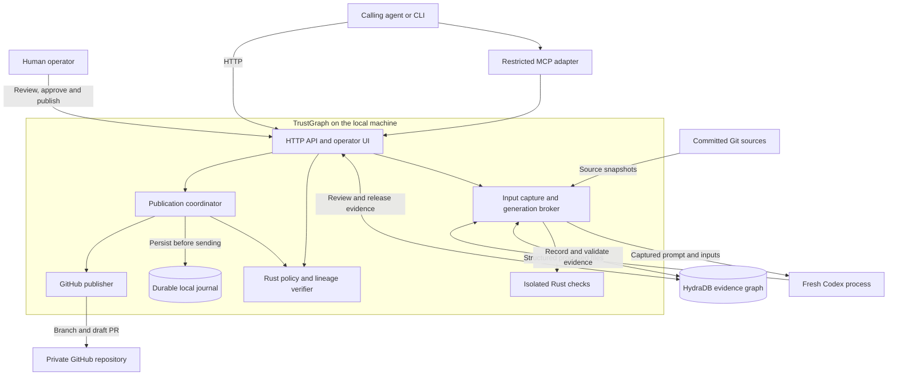
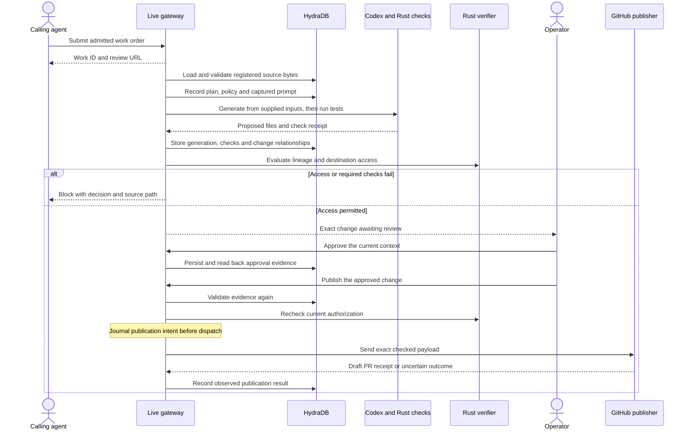
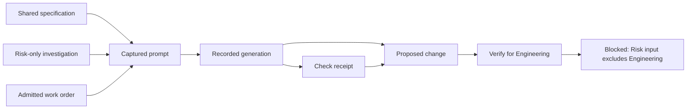
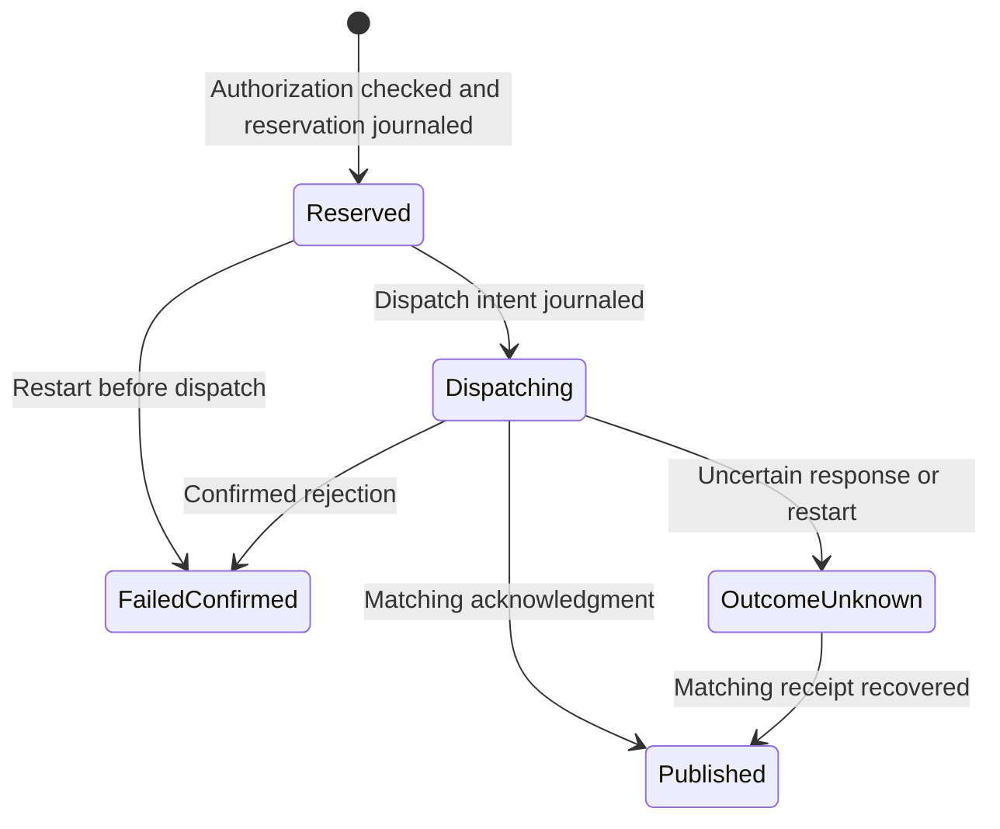

# TrustGraph architecture

TrustGraph is a local governance gateway for agent-generated work. It records
which inputs produced an artifact, derives who may access that artifact, and
requires human approval for its exact publication context. The Rust verifier
makes the authorization decision; the generation model supplies proposed work.

This guide describes the current implementation. See [live setup](development.md)
to run it and [agent integration](agent-integration.md) to connect a caller.

## System overview



The calling agent and the generation process are separate. A caller submits an
admitted task through MCP or HTTP. The broker starts a fresh Codex process with
controlled inputs and tools disabled, then records the proposed files and actual
test results. Publication is a separate human-authorized action.

## Components and code map

| Component | Responsibility | Source |
| --- | --- | --- |
| Core verifier | Validate evidence, traverse lineage, intersect reader sets and check approval | [trustgraph-core](../crates/trustgraph-core/src/lib.rs) |
| Runtime coordinator | Record artifacts and approvals; journal publication state and recovery | [engine.rs](../crates/trustgraph-runtime/src/engine.rs), [journal.rs](../crates/trustgraph-runtime/src/journal.rs) |
| Policy compiler | Validate company policy, resolve groups and enforce configured authority | [policy.rs](../crates/trustgraph-runtime/src/policy.rs) |
| Live gateway | Admit tasks, import sources, coordinate generation, review and publication | [server.rs](../crates/trustgraph-live/src/server.rs) |
| Generation and checks | Capture a fresh Codex result and run the bounded Rust test harness | [runner.rs](../crates/trustgraph-live/src/runner.rs) |
| Hosted evidence adapter | Store and read back records, fingerprints and input relationships | [hydra.rs](../crates/trustgraph-live/src/hydra.rs) |
| GitHub publisher | Check repository access and base commit; publish the exact approved files | [github.rs](../crates/trustgraph-live/src/github.rs) |
| CLI and MCP | Start either UI, submit tasks and expose restricted agent tools | [main.rs](../crates/trustgraph-cli/src/main.rs), [mcp.rs](../crates/trustgraph-cli/src/mcp.rs) |
| Simulation | Explore finite authorization states and reproducible runtime schedules | [trustgraph-sim](../crates/trustgraph-sim/src/lib.rs) |
| Web interfaces | Guided company demo and live operator workspace | [story.js](../web/story.js), [workspace.js](../web/workspace.js) |

The web assets are embedded in the Rust binaries. There is no separate frontend
build or JavaScript package installation.

## From task to publication



At startup, the gateway imports committed bytes from the context repository and
from the target repository's `src/lib.rs`, `README.md` and `Cargo.toml`. Source
versions retain their commit identity and content fingerprint. Uncommitted edits
are outside that imported snapshot.

For each run, the broker records the work order, selected sources, policy,
assembled prompt and ordered input manifest. The fresh Codex process returns
structured file contents. Unexpected tool activity or incomplete capture fails
the run. The check runner compiles and executes the small Rust fixture in an
isolated macOS sandbox; the model's claim that tests passed is not a receipt.

The live wrapper checks allowed paths, changed-file count and required test
results alongside the core authorization decision. Changes to the active policy
or repository base can require regeneration and review.

## Evidence and inherited access

An artifact is an immutable content version identified by a fingerprint. Its
origin is either a registered source or a recorded transformation. A
transformation links its output to an ordered manifest of input occurrences.
Sources refer to current access lists; destinations resolve to explicit readers.



Arrows show information flowing from inputs to derived records. The verifier
walks backward from the proposed output through its full dependency history:

```text
Readers(output) = intersection of the reader sets of all contributing sources
Publication requires Audience(destination) to be a subset of Readers(output)
```

The check includes requester access, workspace identity, content and manifest
fingerprints, graph completeness and a resolved destination. Missing, inconsistent
or over-limit lineage blocks authorization. A denial can identify the restricting
source and the path from that source to the output.

In the live bank case, Engineering can read the shared requirements but cannot
read the Risk investigation. A change generated using both inherits the Risk
restriction, even if its text does not quote the investigation and its tests pass.
A human approval does not grant source access.

**Fresh repair** runs generation again with separately shared inputs, excluding
the investigation and the restricted draft. **Revision** creates a new version
linked to the previous artifact and keeps its dependencies. Rewording an existing
restricted draft therefore cannot remove its source restrictions.

## Exact approval and agent authority

Approval binds the artifact identity and bytes, destination and recipient set,
workspace, action, policy fingerprint, lineage fingerprint and source access
fingerprint. At release, Rust recomputes that context and checks that the signer
is an enabled, eligible human who may access the work. It also checks approval
expiry and revocation. A changed context needs a matching approval.

The live gateway gives callers an agent token for inspection, task submission,
fresh repair and simulation. The operator has a separate capability for review,
publication and policy activation. MCP exposes no approval or publication tool.
In department mode, new task text must match the predefined work order or an
exact work order already admitted by the operator.

The publisher checks the configured private personal repository, its owner-only
collaborator list, the unchanged `main` base commit and the exact checked patch.
It creates a branch and draft pull request. Department identities inside the
model are configured principals; they are not synchronized GitHub team identities.

## Storage, publication and recovery

| Store | What it holds | Role |
| --- | --- | --- |
| HydraDB | Sources, permissions, plans, prompts, generation, checks, approvals, authorization bundles and observed receipts | Connected evidence, with content and relationship validation |
| Local journal | Runtime evidence and durable publication transitions | Reconstruct coordinator state and prevent blind repeat dispatch |
| Local workspace files | Job metadata, run logs, isolated checks and operator/agent capability files | Operate and inspect the local workspace |
| Publisher records | Attempt markers and acknowledged payloads | Preserve the adapter's observed publication outcome |

The journal and workspace files live under the configured state directory. The
example configuration puts them in the ignored `.trustgraph-live` directory.
HydraDB holds evidence; Rust evaluates authorization. The journal preserves
publication intent before any external mutation.



Repeated publication requests with the same operation key and context return the
recorded operation. A key cannot be reused for a different payload. A restart
marks an unfinished dispatch as `OutcomeUnknown`; it does not assume failure and
send again. Journal corruption or uncertain journal writes require recovery.

The runtime supports reconciliation through the publisher's lookup interface.
The current GitHub adapter looks up locally persisted acknowledgments; it does
not search GitHub to reconstruct a lost receipt. An attempt without an
acknowledgment can remain uncertain and requires investigation. This is a limit
of the current adapter, not an automatic recovery guarantee.

If GitHub publication succeeds but the final Hydra receipt write fails, the
journaled outcome is retained and the API reports an evidence synchronization
warning. There is no distributed transaction across local storage, HydraDB and
GitHub. Task submission also has no client idempotency-key contract: after a
lost submission reply, inspect existing work before submitting again.

## Simulation and reproducibility

| Mode | Execution and state | External effects |
| --- | --- | --- |
| Guided demo: `story` | Fictional company data, fixed clock, in-memory journal and simulated publisher | None; restart or reset clears the session |
| Live workspace: `start` | Fresh Codex generation, actual Rust checks, local durable state and hosted Hydra evidence | Explicit operator publication can create a GitHub draft PR |
| Offline analysis: `check-model`, `simulate`, `replay` | Finite model exploration and seeded virtual runtime schedules | None |

The guided policy UI compiles its constrained policy into the Rust company
policy model and displays YAML. The live workspace uses the smaller JSON
`WorkPolicy` contract. See [policy formats](policy.md) for their separate schemas.

Policy comparison evaluates the current and proposed policies against the same
hypothetical case. It does not generate files, run tests, activate the proposal
or publish. The guided demo fixes the evaluation clock, producing identical
fingerprints for identical inputs. Live comparisons use server time and record
evidence in HydraDB, so separate requests need not have identical record IDs.
Offline campaigns fix their seed and schedule and can be replayed.

## Scope

The current integration governs the inputs supplied by its own broker and the
credentials used by its publisher. It does not capture the calling agent's
previous conversation, hidden memory or independent tool executions. Independent
write credentials can bypass the gateway.

The live runner supports changes to `src/lib.rs` and `README.md` in a small Rust
workbench. It does not install dependencies or execute arbitrary project build
scripts. Source readers and reviewer identities are explicitly configured; SSO,
enterprise IAM, multitenancy and remote agent hosting require additional work.
Access tracking and exact review do not establish general code correctness or
prove that generated content contains no sensitive information.
